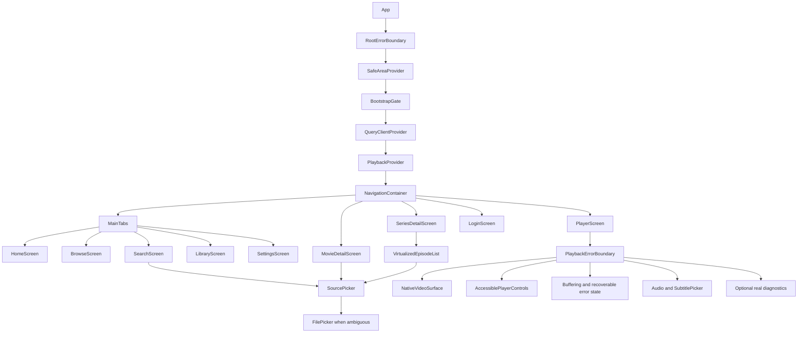
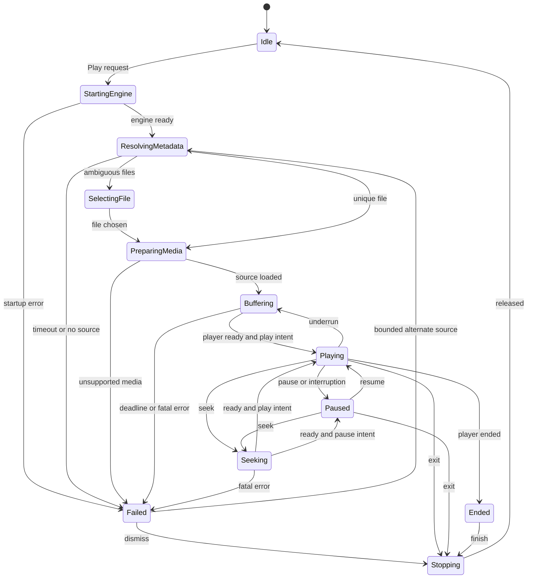

# StreamForge mobile architecture and implementation roadmap

Companion to the [82-issue audit](C:/Users/neilr/Desktop/Torrent/docs/streamforge-mobile-audit.md). This is a proposed design, not implemented application code.

## Recommended architecture

Keep React Native/Expo, React Navigation and Zustand. Use **expo-video** for the first working Android player and a **local Expo native module** implemented in Kotlin to wrap the gomobile AAR. Put session lifecycle in a single playback controller and a native engine owner. Do not carry media bytes through JavaScript.

The Go AAR is embedded native code loaded into the Android app process. It is not the standalone main.go process and does not use Unix signals for its lifecycle. “Daemon” can remain the component's name, but its lifetime must be managed through Android/native APIs.

Use the existing core policies where they fit; isolate WebTorrent internals and desktop-specific codec assumptions. Define native capability support explicitly so unsupported features cannot silently pretend to succeed.

| Layer | Owns | Must not own |
|---|---|---|
| Screen/components | Rendering, input, transient sheet/control state | Engine startup, independent timers pretending to be media time |
| Playback controller | Session transition graph, request generation, source choice, resume, fallback, final cleanup | Torrent piece storage or decoder internals |
| Catalog repository/query cache | Normalized movie/show/season/episode models, requests, caching, retries | Player time or credentials |
| Zustand | Persisted preferences/library snapshots and low-rate session projection | Native player objects, reader handles, media bytes |
| Credential service | Secure token/key storage, refresh serialization, account generation | General watch history persistence |
| Kotlin module/engine owner | AAR lifecycle, dispatch, typed errors, event subscription, Activity/service coordination | Business ranking policy duplicated from JS |
| Go engine | Torrent metadata, file selection, reader leases, bounded cache, native stats | React state or clock simulation |
| HTTP media server | Loopback media bytes, Range/HEAD, session authorization, request cancellation | Public unauthenticated torrent administration |
| Native video player | Decode, clock, seeks, audio focus/track capability, buffering truth | Durable account data |

Expo documents local modules and development builds for custom native code. Expo Go cannot load an AAR that is not part of its binary. [Custom native code](https://docs.expo.dev/workflow/customizing/), [module creation](https://docs.expo.dev/more/create-expo-module/).

## Complete playback data flow

```mermaid
sequenceDiagram
    actor U as User
    participant UI as Detail or Search
    participant PC as Playback controller
    participant N as Kotlin module
    participant G as Go engine
    participant H as Loopback HTTP
    participant V as expo-video / native player
    participant S as Stores / persistence

    U->>UI: Tap Play or choose source
    UI->>PC: Full magnet + content key + episode/file hints
    PC->>PC: Validate, allocate request ID, cancel superseded request
    PC->>N: ensureStarted()
    N->>G: Create engine and owned cache
    N->>H: Bind loopback listener
    H-->>N: Bound endpoint + generation
    N-->>PC: Ready + protocol/capabilities
    PC->>N: createSession(request)
    N->>G: Add magnet; await metadata with cancellation
    G-->>PC: File candidates + canonical hash
    alt File choice ambiguous
        PC-->>UI: Show file selection
        U->>UI: Choose exact file
        UI->>PC: File index
        PC->>N: selectFile(session, index)
        N->>G: Commit selection for this session
    end
    G->>G: Prioritize verified head/tail and reader readahead
    N-->>PC: Session + authenticated stream URL + metadata
    PC->>V: Load URI with session headers
    V->>H: GET /v1/sessions/id/media with Range
    H->>G: Open independent reader for selected file
    G-->>H: Requested file bytes
    H-->>V: 200/206 response and media bytes
    V-->>PC: Ready, duration, tracks, time, buffering, error
    PC->>V: Apply validated resume after metadata
    PC-->>UI: Playback projection
    G-->>N: Torrent/selected-file statistics
    N-->>PC: Throttled stats tagged by session/generation
    PC->>S: Save real progress periodically
    U->>UI: Seek
    UI->>V: Seek in media time
    V->>H: Range at actual extractor byte offset
    H->>G: Reader seek drives piece priority
    U->>UI: Back / Stop
    UI->>PC: Dispose session
    PC->>S: Flush final measured progress
    PC->>V: Stop and release source
    PC->>N: Cancel/close session
    N->>G: Close readers; release torrent/cache lease
```

A timestamp is not a reliable byte offset for variable-bitrate media. Let the native extractor issue ranges; use actual reader positions to drive demand. A playhead estimate can influence prefetch, but must not select the bytes returned to ExoPlayer.

A hash is also not a session: one pack can contain several episodes, and one movie may use several hashes across fallback sources. Model all three identities separately:

```text
contentKey: stable movie or episode identity for history/watchlist
sourceKey:  canonical infoHash plus file identity where known
sessionId: unique playback attempt, with engine generation and request sequence
```

Retain the original full magnet. A hash-only magnet can sometimes work via DHT, but it discards tracker/web-seed/private discovery information and is not a faithful replay request.

## Component hierarchy



Use reusable Presentational components: MediaCard, CatalogRow, CatalogGrid, EmptyState, ErrorState, SourceRow, SeasonSelector and EpisodeRow. Keep catalog/query hooks and playback commands out of those components. Layout parents own grid spacing; cards should not add unconditional right margins.

Do not place app-wide high-frequency playback subscriptions above the navigator. Timer/control updates should only rerender the player widgets that display them.

## State machine and ownership



The diagram shows common transitions. **Every active state also accepts cancel/exit**, including metadata resolution, file picking and seeking. Cancellation must run even if the screen never received a stream URL.

Maintain an immutable request generation. Async completion checks both request generation and engine generation before updating state. Native cleanup identifies the exact session, not whichever torrent now happens to share its hash. A late obsolete createSession success is immediately released.

Keep play intent separate from buffering/ready state: rebuffering must not undo an explicit pause. Separate media position from engine download progress. Keep unknown duration, codecs and stats as null/unknown, never fabricated defaults.

A single lifecycle owner should:

1. Allocate and cancel each request.
2. Await startup once, with shared in-flight startup deduplication.
3. Resolve file selection before player attachment.
4. Register player/native event handlers before loading the source.
5. Flush measured progress, stop the player and cancel readers on exit.
6. Release subscriptions, timers, orientation/wake resources and leases exactly once.
7. Keep failed/cancelled callbacks from resurrecting stopped sessions.

Native lifecycle states should similarly be stopped → starting → running → stopping → stopped, with an error result for startup failure. Do not hold a global mutex while resolving metadata or performing shutdown. Use narrow state locks plus operation cancellation/refcounts.

## State-management map

| State | Owner/storage | Update strategy |
|---|---|---|
| Catalog/search/season/episode data | TanStack Query + normalized repositories | Query keys include provider, ID, query, filter, page; cancel stale requests; bounded gc/stale policy |
| Watchlist/history | Account-scoped Zustand + AsyncStorage | Versioned validated snapshots; durable dirty queue; stable content identities |
| Playback preferences | Zustand + AsyncStorage | Persist only supported nonsecret preferences; narrow selectors |
| Access token | Credential service, memory | Refresh single-flight; short-lived token never exposed to general UI state |
| Refresh token and user-supplied provider keys | SecureStore | Async read/write, explicit invalidation and account generation |
| Live playback position/buffer/track state | Native player + local controller projection | Time events around 2 Hz for visible UI, history writes about every 10 seconds plus terminal flush |
| Torrent progress | Go → module → session-specific observer | Around 1 Hz initially; pause observers when unneeded; actual rates and selected-file totals |
| Active engine/session handle | Native owner + controller references | Never persist handles or native URLs across restart |
| Source picker visibility, selected tab, control visibility | Component state | Reset on request/session change |
| Network/reachability | NetInfo + API results | Distinguish offline, backend unreachable and no peers |
| Cloud synchronization | Account-scoped sync service/outbox | Debounced after mutations and on eligible foreground/reconnect; retry with backoff |

TanStack Query has specific React Native integration for AppState/focus and online state. Hook these once at app infrastructure level; do not interpret “network connected” as proof that the backend or swarm works. [React Native integration](https://tanstack.com/query/latest/docs/framework/react/react-native).

### AsyncStorage migration

The current synchronous StorageAdapter is the main design constraint. Do not cast AsyncStorage to it and do not launch unawaited token writes.

Recommended migration:

- Convert reusable store construction into factories receiving persistence and services. Keep desktop's existing adapter through a compatibility implementation and test both platforms.
- Use Zustand persist with an AsyncStorage-backed JSON storage for ordinary mobile data. Configure version, partialize, schema validation/migration and controlled hydration.
- Hydrate preferences and current account's library before normal screen effects can write defaults. Expose hydration error/retry rather than leaving the splash indefinitely.
- Bootstrap credentials separately through SecureStore, then restore/refresh the session. Rehydrate the account namespace after knowing its identity.
- Persist only data fields: no Maps of engine sessions, functions, native objects, URLs with capability tokens or player state.
- Queue/coalesce writes so an older async write cannot land after a newer snapshot. Report persistent write failures; retain an in-memory dirty snapshot for retry.
- Migrate existing keys once into guest/account-scoped records. Treat old hash-only history as legacy source identity; do not invent catalog keys.
- On account switch, invalidate all cloud tasks. Guest-data merge should be an explicit user action; never silently import another account's data.
- Use revisions and deletion tombstones in cloud sync. Merge by logical content key and timestamp/revision, sort history, then cap it.

Zustand persist supports versioning, migrations, partial persistence and manual hydration; custom deserialization should validate stored values. [Persist middleware](https://zustand.docs.pmnd.rs/reference/middlewares/persist.html). SecureStore is the Expo facility for encrypted local key/value credentials. [SecureStore](https://docs.expo.dev/versions/latest/sdk/securestore/).

### API configuration and DTO normalization

Read `process.env.EXPO_PUBLIC_API_BASE_URL` **in the mobile app's bootstrap module**, validate it as an absolute URL, require HTTPS in production, and inject it into APIClient. Keep Vite-specific configuration in desktop bootstrap. Normalize the trailing slash so endpoint joining is predictable. Never use EXPO_PUBLIC for secrets.

For development, choose one explicit backend route: a reachable LAN address, HTTPS development endpoint, or adb reverse. Android emulator host networking differs from physical devices; 127.0.0.1:8888 always refers to the on-device torrent endpoint. Ngrok for Metro does not automatically expose your API.

Introduce discriminated catalog identities:

```ts
type CatalogIdentity =
  | { provider: 'streamforge'; kind: 'movie' | 'series'; id: string; slug: string }
  | { provider: 'tvmaze'; kind: 'series'; id: number }
  | { provider: 'cinemeta'; kind: 'movie'; id: string }
  | { provider: 'yts'; kind: 'movie'; id: number };
```

Normalize backend and provider DTOs at the repository boundary. Screens receive one shape with numeric nullable rating, string genres, canonical poster URLs, normalized season/episode fields and source candidates. Map backend magnet_links explicitly. Namespaced IDs remove number-vs-string guesses and numeric mock collisions.

Transport contract: optional caller AbortSignal, finite deadline, structured HTTP/error code, validated body, bounded retry, and consistent success/empty-response handling. Retry idempotent reads; do not blindly replay mutations after uncertain responses. Refresh at most once through a shared refresh operation, reject stale-account retries, and retain offline sessions on temporary network loss.

## Native bridge and HTTP contracts

These are **proposed interfaces**; they do not exist in the scaffold.

```ts
type PlaybackRequest = {
  requestId: string;
  contentKey: string;
  magnetURI: string;
  fileIndex?: number; // zero is valid; undefined means resolve
  episode?: {
    seasonNumber: number;
    episodeNumber: number;
    absoluteEpisodeNumber?: number;
    aliases?: string[];
  };
  resumeSeconds?: number;
};

type SessionResult = {
  protocolVersion: 1;
  engineGeneration: string;
  sessionId: string;
  infoHash: string;
  state: 'selecting-file' | 'prepared';
  files: Array<{
    index: number;
    path: string;
    lengthBytes: number;
    mediaType: string | null;
  }>;
  selectedFileIndex: number | null;
  stream: { uri: string; headers: Record<string, string> } | null;
};

interface TorrentEnginePort {
  start(): Promise<{ protocolVersion: 1; generation: string }>;
  createSession(request: PlaybackRequest): Promise<SessionResult>;
  selectFile(sessionId: string, fileIndex: number): Promise<SessionResult>;
  cancelRequest(requestId: string): Promise<void>;
  closeSession(sessionId: string): Promise<void>;
  stop(): Promise<void>;
}
```

Stats/events additionally carry generation, sessionId, event sequence, status, peers, measured transfer rates, selected-file completion and available contiguous bytes. Map Go's native types to a versioned JSON schema, validate once at the JS boundary, and do not force unknown Go metrics into fictional TorrentProgress values.

Expose a capabilities object such as fileSelection, stats, cacheManagement, downloads and backgroundPlayback. Current mobile download methods should return an explicit unsupported result. Stream-only v1 does not need a download queue.

Use primitive/JSON/string + error signatures at the exported Go binding boundary. Keep context.Context, torrent.File, io.Reader and engine internals behind it. A recommended Go start operation returns `(string, error)`, not a magic ERROR string; inspect generated Java signatures and wrap errors into rejected JS promises.

Kotlin AsyncFunction/coroutine dispatch must keep blocking startup/metadata/cache operations off Android's main thread. Cancellation needs a real Go entrypoint tied to a request/session context; cancelling a JS promise or coroutine alone is not enough. An invalidated RN runtime unsubscribes events and releases its leases without racing the next runtime.

### HTTP media semantics

Prefer native control methods and leave only a small media/health surface on HTTP. If HTTP control endpoints remain, they need the same auth/validation rules and correct methods.

Proposed media URI: `http://127.0.0.1:<bound-port>/v1/sessions/<session-id>/media`. Use a random per-run capability carried in request headers. Bind explicitly to loopback; choose an available port or fail visibly if 8888 is occupied. Never silently return a URL for an unbound server.

Each GET/HEAD:

- Authenticates before revealing metadata.
- Resolves an immutable session/file selection and acquires a reader lease.
- Opens an independent read/seek/close reader.
- Returns correct MIME, stable length and valid 200/206/416 behavior; HEAD does not download the body.
- Supports open-ended and suffix ranges and the native player's concurrent requests.
- Connects request cancellation/deadline to missing-piece waits, then closes reader and releases lease.
- Uses stable file identity/validators. Do not set Last-Modified to “now” on every request.
- Never shares a mutable seek cursor between requests.

Go's ServeContent is a useful range implementation; do not rewrite range parsing without need. Wrap its reader with context-aware Read while preserving Seek/Close, define a stable file length, and test exact bytes. Header/write timeout values cannot substitute for cancellation of blocked torrent reads.

For release Android, configure a narrowly scoped loopback cleartext exception through an Expo config plugin and verify the merged manifest/network-security resource and actual native player's requests. Keep remote APIs HTTPS. Do not assume Go networking and Java media networking enforce identical policies.

## Torrent scheduling, storage and resource budgets

Stream-only means **temporary data**, not “no bytes touch disk.” A seekable multi-gigabyte stream needs deliberate storage. Start with app-private ephemeral disk caching and a quota; an unbounded in-memory piece store is not a practical mobile default.

The selected-file lifecycle must own:

- Torrent metadata and canonical file list.
- File selection and exact file-relative length/offset.
- Reader demand windows, startup head/tail requirements and bounded readahead.
- Active readers and reference-counted torrent ownership.
- Temporary cache manifest and quota accounting.
- Cancellation and final cleanup, including process-death orphan recovery.

File.Download() alone does not implement a bounded streaming policy. Limit priority to actual playback needs; if whole-file caching is initially allowed, label it accurately, enforce a hard maximum/free-space reserve and fail predictably before exhausting disk. Do not introduce sliding eviction until storage completion bookkeeping is correct: evicted pieces must no longer be advertised as available, readers must remain safe, and backward seeks may require reacquisition.

Define measured targets for the first controlled-device prototype: one active playback session, a small bounded pending-selection pool, capped provider concurrency, 1 Hz torrent stats and a configurable disk quota. Tune connection count, Go memory target, image cache and readahead using RAM/thermal/network measurements. A per-torrent 40-peer limit is not a total app memory budget.

On cancellation: close player data source, cancel request contexts, close readers, drop torrent only after last lease, then clean owned cache files. On startup: inspect owned session manifests and clean abandoned sessions without deleting unrelated files. On low storage: stop scheduling, report a recoverable storage error and release safely.

Uploading is currently enabled. The product should state its bandwidth behavior, stop transfers on session disposal and provide metered-network controls if needed. Do not claim stream-only eliminates upload traffic.

## Video library decision and integration

| Option | Decision |
|---|---|
| expo-video | Recommended first integration. Matches Expo and exposes native video playback/events. The installed SDK's compatibility metadata recommends ~57.0.4; install through expo install. |
| react-native-video | Consider only if the expo-video prototype proves a specific needed capability is missing. Validate the chosen version's Expo57/RN0.86 compatibility and migration cost before switching. Do not maintain two players initially. |
| Custom Media3 bridge | Escalation path for required extractor/data-source/service/track functionality that the wrapper cannot expose. Highest native ownership cost. |
| expo-av | Do not choose for new work: deprecated and removed from SDK55 onward. |

The recommendation relies on Expo's supported video API, including useVideoPlayer/VideoView and status/time/source events. [expo-video](https://docs.expo.dev/versions/latest/sdk/video/). The legacy AV removal is documented in the [SDK55 upgrade notes](https://expo.dev/blog/upgrading-to-sdk-55).

Implementation sequence:

1. Prove native playback of a known bundled or HTTPS H.264/AAC fixture, independently of torrents.
2. Prove the same fixture through the authenticated loopback server using full and ranged requests.
3. Mount one VideoView and one useVideoPlayer instance per session. Begin with native controls to validate transport, then add accessible custom controls.
4. Create the player with no source, attach event handlers, then load the session's URI/headers. Keep native handles in refs/hooks.
5. On source metadata, validate duration and tracks, calculate resume using getPlaybackResumeTime, seek once, then honor current play intent.
6. Derive currentTime, duration, playing and buffering from native events. Configure periodic time events; write real progress through a stable scheduler.
7. Set seeks on the native player. Discard stale old-source events using session identity.
8. Treat decoder/source/network failures differently; give explicit retry/select-source/exit actions.
9. Release player/data source before final engine cleanup. Prevent JS state updates from disposed instances.

A container being supported does not guarantee that its audio/video codecs, profile, bit depth or device decoder are supported. Use actual track/capability information and a tested media matrix. Avoid assuming “ExoPlayer” guarantees hardware decode or handles every MKV audio track. [Media3 progressive formats](https://developer.android.com/media/media3/exoplayer/progressive).

For v1, prefer compatible alternative sources instead of promising local software transcoding. If a source is unsupported, explain that and offer another. On-device transcoding adds CPU, thermal, native-size and codec-distribution complexity that is not implemented here.

Subtitles: start with selectable native text tracks where available. For downloaded subtitles, validate provider language codes, include episode identity, select the correct release, limit size, and convert/store an appropriate timed-text format if required by the native API. Respect off/auto/always, clear old cues, allow timing offset, and define unsupported bitmap/ASS styling behavior explicitly.

## Go/AAR build plan

First install a pinned supported Go toolchain plus Android SDK, NDK and JDK appropriate for the Expo-generated Android project. Pin golang.org/x/mobile to a tested revision; the go directive alone does not lock the compiler. Use a documented Linux CI runner if the local Windows toolchain proves awkward.

Build the library package under daemon/mobile, not daemon/main. The Go mobile tooling generates Android AAR bindings from a Go package. [Go Mobile guide](https://go.dev/wiki/Mobile).

The following is a **command template for the future native-build script**, run from the daemon module in an isolated build environment. Replace the version/API variables with pinned values; these commands were not executed during the audit.

```powershell
$env:GOWORK = 'off'
# PINNED_X_MOBILE_VERSION and PINNED_ANDROID_API are build-script inputs.
go install "golang.org/x/mobile/cmd/gomobile@$env:PINNED_X_MOBILE_VERSION"
go install "golang.org/x/mobile/cmd/gobind@$env:PINNED_X_MOBILE_VERSION"
gomobile init
go mod tidy
go mod verify
go test ./...
go vet ./...
gomobile bind -target=android/arm64,android/amd64 -androidapi $env:PINNED_ANDROID_API -o ./build/torrentdaemon.aar ./mobile
```

The build script creates the output directory first, records tool versions, pins all dependency changes and retains go.sum. Run go test -race on a supported host/CGO toolchain separately. Keep GOWORK=off local to the native build so unrelated backend modules do not expand this target; do not permanently change developer workspace settings.

Then:

1. Create the local Expo module with Kotlin implementation and autolinking metadata.
2. Package the AAR as a reproducible dependency. Prefer a local/Maven repository artifact for Android library-module compatibility; do not assume arbitrary file-based AAR inclusion works for every Gradle library configuration.
3. Wire generated Java bindings using their actual inspected package/class/method names.
4. Ensure supported ABIs: arm64 device and x86_64 emulator first, additional ABIs only if the product requires them.
5. Add config plugin changes for native networking, package assets and optional lifecycle permissions; ensure regeneration preserves the module/dependency.
6. Build a development APK and exercise start/health/stop before torrent playback.
7. Build a minified release and verify JNI symbols/generated classes survive shrinking; package consumer keep rules only where needed.
8. Verify ELF and APK alignment for 16 KB page-size devices, including Go-produced libraries, then test on an appropriate emulator/device. [Android page-size support](https://developer.android.com/guide/practices/page-sizes).
9. Keep protocol/build version in both AAR and JS. Reject incompatible combinations; native-module changes require a new binary, not merely a JS update.

Android lifecycle policy for v1: playback is foreground-only, pauses on background/audio interruption, and exits release transfers. If PiP/background playback is required later, coordinate media session, foreground service, notification and engine owner under one design; enabling a player flag alone does not keep torrent lifecycle correct.

## Folder structure

All paths below are proposed beneath the current workspace.

```text
streamforge/
  apps/mobile/
    src/
      app/
        App.tsx
        bootstrap.ts
        providers.tsx
        linking.ts
      config/
        environment.ts
      navigation/
        RootNavigator.tsx
        types.ts
      features/
        catalog/
          screens/
          components/
          queries.ts
          repository.ts
          normalize.ts
        search/
          SearchScreen.tsx
          queries.ts
        playback/
          PlayerScreen.tsx
          PlaybackController.ts
          stateMachine.ts
          lifecycle.ts
          components/
            NativeVideoSurface.tsx
            PlayerControls.tsx
            SourcePicker.tsx
            FilePicker.tsx
            TrackPicker.tsx
        library/
          LibraryScreen.tsx
          persistence.ts
          sync.ts
        auth/
          LoginScreen.tsx
          credentials.ts
          session.ts
        settings/
      infrastructure/
        api/
        native/
          TorrentEnginePort.ts
          ExpoTorrentEngine.ts
        storage/
        observability/
        network/
      shared/
        ui/
        theme/
    modules/torrent-daemon/
      expo-module.config.json
      src/
      android/
        build.gradle
        src/main/java/.../TorrentDaemonModule.kt
    plugins/
      withTorrentDaemon.ts
    assets/
    tests/
    app.config.ts
  packages/core/
    src/
      domain/
      policies/
      contracts/
      repositories/
      stores/           # injectable factories / compatibility exports
    tests/
  services/torrent-daemon/
    engine/
      engine.go
      session.go
      selection.go
      cache.go
      stats.go
    server/
      stream_server.go
      auth.go
    mobile/
      bridge.go
    main.go             # standalone host/debug executable
    tests/
    go.mod
    go.sum
  scripts/
    build-mobile-native.ps1
    verify-mobile.ps1
  docs/
    streamforge-mobile-audit.md
    streamforge-mobile-architecture.md
```

Migrate feature by feature and keep compatibility exports while desktop is still consuming the current shared API. Avoid a monorepo-wide rewrite before the first native playback proof.

## Missing-production-capability inventory

| Capability | Current state | Minimum production implementation | Priority |
|---|---|---|---|
| Video rendering | Placeholder | Native player, true events, resume/seek/end/error | P0 |
| Torrent startup | No compiled native bridge | Reproducible AAR/module, startup readiness and health | P0 |
| Source-to-player flow | Hash navigation only | Full request → metadata → exact file → stream | P0 |
| Catalog/library crashes | Known source-level paths | DTO normalization, keyed list switch, link validation | P0 |
| Native session lifecycle | Unsafe singleton/scattered maps | Generations, cancellation, leases, deterministic stop | P1 |
| Range transport | Basic ServeContent scaffold | Auth, method validation, correct file, reader close/cancel | P1 |
| Cache | Whole file/unbounded; fake clearing | Owned bounded disk cache, free-space checks, real clear/size | P1 |
| Auth | API methods exist, failure flow broken | Correct errors, secure credentials, refresh/session epochs | P1 |
| Preferences/history/watchlist | Synchronous memory fallback | Async validated persistence, migrations, account scope | P1 |
| Cloud sync | Best-effort logout sync | Durable mutations, revisions/tombstones and conflict handling | P1 |
| Catalog/search | any DTOs, silent mocks, stale races | Typed normalization, query keys, cancellation/error states | P1 |
| Episode selection | Mixed schema, missing file hints | Normalized identity, season packs, absolute-number support | P1 |
| Source quality | Rankings partly used, synthetic stats | Eligibility vs ranking, actual/unknown metrics, device capability | P1 |
| Autoplay/fallback | Settings only | Bounded state-machine workflows, correct content resume | P1 if advertised |
| Subtitles/audio | Partial online overlay/fake tracks | Mode-aware selection, real tracks, episode match, capability handling | P1 if advertised |
| Offline/background | Undefined | Offline library/error UX; explicit foreground playback policy | P2 |
| Accessibility/layout | Largely absent | TalkBack, 48dp targets, safe areas, adaptive grids and font scaling | P2 |
| Images/lists | Basic image/list components | Fallbacks, bounded caches, responsive virtualization | P2 |
| Observability | console logs | JS/native crash capture, redaction, symbols/source maps, session metrics | P2 |
| Build/distribution | Mobile dev scripts only | Locked CI, signed release, ABI/page-size tests, update compatibility | P0 build / P2 release |
| Downloads | Fake methods | Explicit unsupported capability; real downloads deferred | P3 cleanup |
| OAuth/PiP/transcoding | Not implemented | Hide until deliberately implemented and tested | Optional scope |

## Implementation milestones and acceptance gates

Work in this dependency order. Effort depends strongly on native-build/toolchain and media-format findings; these are milestones, not unsupported calendar promises.

| Milestone | Work | Exit gate |
|---|---|---|
| M0: trustworthy baseline | Fix SF-001/004/005/006/008/028/031/039; add DTO regression fixtures, pin toolchains, disable fake success | Clean TS checks; library/login/catalog regression tests; daemon packages compile; config assets resolve |
| M1: player/transport prototype | Add expo-video; compile local module/AAR; correct start/stop; implement auth/reader cleanup for loopback fixture | Debug and release device play the fixture over localhost; seek/head/suffix ranges correct; port conflict is visible |
| M2: one real torrent | Full magnet request, canonical metadata, exact file selection, real torrent-driven reads and typed errors | Controlled seeded test movie reaches first frame; seek/stop/replay work; no made-up duration/stats; no orphan session |
| M3: durable application state | Async persistence, SecureStore, account generation, API injection/refresh, cloud outbox | Restart preserves library/settings; offline launch remains usable; account isolation and failed-login tests pass |
| M4: complete movie/episode flow | Normalized catalog repository, stale request guards, packs/absolute numbering, source ranking, real resume/subtitles/fallback | Backend movie and E5 fixtures work; changing sources preserves content progress; superseded requests never win |
| M5: Android hardening | Lifecycle/audio focus, safe areas/TalkBack, cache quotas, bounded provider/image work, reporting | Rotation/background/network loss/low-storage/rapid seek stress passes; no monotonic reader/session/cache growth |
| M6: release readiness | Signed minified release, ABI/16KB checks, physical-device matrix, symbols/maps, staged rollout/rollback | Reproducible artifact and documented test evidence; all P0/P1 resolved or feature disabled |

Do not wait for a polished catalog before proving M1/M2. The highest uncertainty is native torrent + range + media behavior on real Android hardware.

## Testing strategy

| Layer | Meaningful cases |
|---|---|
| Pure core unit tests | Strict magnet/base32/boundary parsing; source hash+file dedup; unknown stats; non-Latin and near-match titles; eligibility/ranking; resume; season 0; subtitle overlap; history metadata |
| Store/controller tests | Failed auth result; async hydration/write ordering; corrupt snapshot migration; account switch with pending sync; single-flight refresh; logout during refresh; add/close races; stale native events; ten-second progress cadence |
| React Native component tests | Library tab switch; genre objects after normalization; E5 search request; loading/empty/error distinction; query change/clear and unmount; accessible labels and disabled states |
| Repository contract tests | Serialized Go movie/show/auth response fixtures, not separately invented TypeScript shapes; missing/null fields, HTTP non-JSON errors, 204 and 401 |
| Go unit/httptest | Metadata cancellation, invalid index, selected non-largest video, same-hash distinct sessions, 200/206/HEAD/416, suffix/open ranges, reader close on disconnect, tokens/methods/body limits, shutdown deadline |
| Go concurrency tests | Race detector on host for start/stop/add/stats/cleanup; blocked piece read cancellation; generation mismatch; refcounts/cache cleanup after final reader |
| Native instrumentation | AAR startup failure/restart, JNI exceptions, RN reload, native event unsubscribe, lifecycle pause/stop, exact loopback release policy |
| Android E2E | Controlled local seeder fixture; movie and pack episode play; resume after process death; rapid seek/source changes; app links cold/warm; orientation; audio focus; network switch; no peers; low disk; TalkBack |
| Media compatibility | MP4 front/tail moov, MKV, WebM, supported H.264/AAC baseline; HEVC/10bit and uncommon audio tested as supported or clear rejection; multiple tracks, short files, long files and partial availability |
| Release tests | Hermes release bundle, minification, signed APK/AAB, device ABIs/page sizes, crash-symbol resolution, no secret leakage and no fake metrics/demo fallback |

Use a controlled seeder with a small redistributable video and known multifile torrent; public swarm availability makes a poor CI oracle. Separate “engine streams correct bytes” from “native player supports this media.”

Suggested libraries/tools: retain the project's core Node tests for pure policies; use jest-expo plus React Native Testing Library for component/controller integration, Go test/httptest/race for native engine logic, and one Android E2E runner (for example Maestro) with instrumented lifecycle tests where required. Pin versions compatible with the installed SDK instead of installing arbitrary latest versions.

Add targeted budgets to controlled-device tests: first-frame latency under a known seeder, rebuffer frequency, seek completion, JS/UI frame time, Go/native/Java heap, open readers/file descriptors, disk high-water mark, upload/download volume and thermal behavior. Establish the baseline first; don't report invented performance improvements.

## Error handling and operational readiness

Define user-facing errors such as ENGINE_UNAVAILABLE, PORT_IN_USE, METADATA_TIMEOUT, NO_PLAYABLE_FILE, AUTH_REQUIRED, NETWORK_OFFLINE, UNSUPPORTED_MEDIA, STORAGE_FULL and SESSION_CANCELLED. The error carries recoverability and allowed actions; cancellation should not become a red failure banner.

Use a root error boundary for a recoverable app shell and a playback boundary for render faults. Handle promise/native errors in their own layers. Capture structured session events with monotonic timings so “metadata wait,” “buffering,” and “decoder failure” are distinguishable.

A React Native crash SDK such as @sentry/react-native is a reasonable choice; the installed Expo compatibility metadata lists a supported version. Validate its current setup against the chosen build pipeline. Upload Hermes source maps and native symbols in CI; test one deliberate development crash and ensure it resolves correctly. Go panic handling and diagnostics need separate validation—do not assume a JS crash SDK symbolicates Go stacks.

Keep tokens, endpoint API keys, authorization headers, full magnets, subtitle download links and private titles out of routine crash payloads. Correlate with opaque request/session IDs, engine/protocol version, selected-file size and sanitized error codes.

Release work still includes signing/key ownership, build/version codes, reproducible artifact retention, supported Android versions, dependency/license review, accurate product/privacy descriptions and a tested rollback/update strategy. Native protocol changes require coordinated binaries and JS. These are delivery tasks; no deployment, credential changes or publication was performed during this audit.
